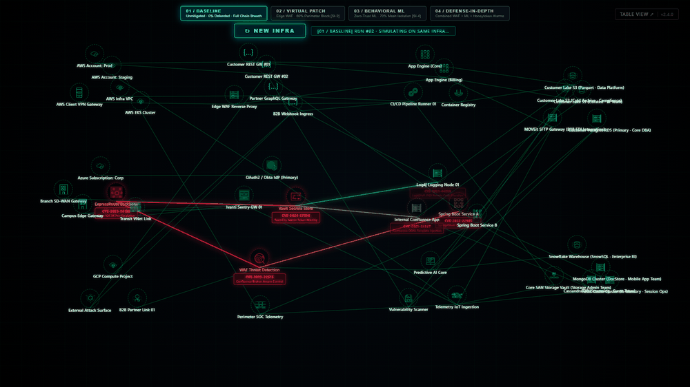

# ARTEX Attack and Defense Demo

An interactive visual demonstration of an attacker moving through an enterprise environment and the potential effects of layered defenses. The wire diagram shows a generated infrastructure, representative attack paths, vulnerability details and a rolling stream of SOC tickets.

The demo is illustrative: its infrastructure, access paths, alerts and defense outcomes are generated for presentation. They are not observations of a real environment or measurements of a product's effectiveness.



## Get and start the demo

Clone the current repository:

```powershell
git clone https://github.com/ash-at-ncs/artex_sandbox.git
cd artex_sandbox
```

On Windows, install Python 3 and make sure `python` or the Python launcher `py` is available on your PATH. Then double-click **`start.bat`** in the repository folder, or run it from PowerShell:

```powershell
.\start.bat
```

The batch file runs `start.py`, which starts a local HTTP server and opens [http://localhost:8080/wire.html](http://localhost:8080/wire.html) in your browser. Keep the launcher window open while using the demo; press **Ctrl+C** in that window to stop it.

If port 8080 is already in use, the launcher opens the existing service at that address rather than starting another server. If neither `python` nor `py` is available, `start.bat` attempts to open that address but does not start a server.

On macOS or Linux, run `./start.sh` from the repository folder; it looks for `python3` and then `python`. A separate [tabular view](http://localhost:8080/index.html) is also available through the **Table View** link.

## Run the wire diagram

1. Select a scenario at the top to start a run. The animated path shows probes, affected objects and defenses as the attack moves through the environment.
2. Switch scenarios to compare the same generated infrastructure and assigned exposures. Each selection starts another run.
3. Select **New Infra** to generate a different environment and start a run.
4. Hover over an object for the assigned CVE and a short attack description. Click an object to reveal its connections briefly. Green connections also appear while an object is being scanned; attack and defense paths use their own colors.
5. Watch the compact SOC ticket stream in the bottom-right corner. Tickets appear as objects are reached, with additional tickets for modeled WAF, SOAR and canary responses. The stream continues to roll after the run ends.

The run status at the top summarizes compromised objects, containment and whether the data layer was reached. Generated infrastructure and the selected scenario are saved in browser storage for subsequent visits.

## Scenarios

The demo has a baseline and three defense scenarios: **virtual patching**, **agentic SOAR**, and **both defenses together with a canary**.

| Scenario | What the demo shows |
| --- | --- |
| **Baseline** | An attack path without the modeled defenses. |
| **Virtual Patch** | A WAF virtual patch blocks eligible requests when the modeled rule and coverage apply. |
| **Agentic SOAR** | An assumed detection and response can contain eligible activity inside the environment. |
| **Defense-in-Depth** | Combines **virtual patching + agentic SOAR + a backend canary**. If the attack reaches the canary, it triggers an alert and a modeled SOAR containment response. |

The same infrastructure is reused across scenario selections. Defense rules, coverage, detection and response are demo assumptions; a blocked path does not establish that a real product would detect or prevent the activity.

## Infrastructure and tickets

The diagram spans internet-facing access, gateways and security controls, internal applications, and data stores. Objects are assigned product-specific CVEs where modeled; other findings can represent public access or assumed credential use. The displayed attack descriptions identify the type of flaw, while an assigned exposure assumes an affected configuration.

An environment may include one network-monitoring system, selected from Cacti, LibreNMS, SolarWinds NPM, Zabbix, PRTG and ManageEngine OpManager. The selection has a 90% inclusion chance before topology filtering. Some products have a mapped historical CVE; others have no CVE assigned.

The SOC tickets are illustrative, generated as activity occurs. A node can produce one or several tickets, with a title, severity and short alert description. Severity and breach detection are demonstration choices, not CVSS scores or actual SIEM findings. Remediation tickets appear when a modeled virtual patch, agentic SOAR response or canary triggers.

See [wire diagram logic](docs/wire_diagram_logic.md) for the topology and scenario assumptions, and the [threat matrix](docs/cisa_kev_threat_matrix.md) for additional vulnerability background.

## License

[Apache License 2.0](LICENSE).
